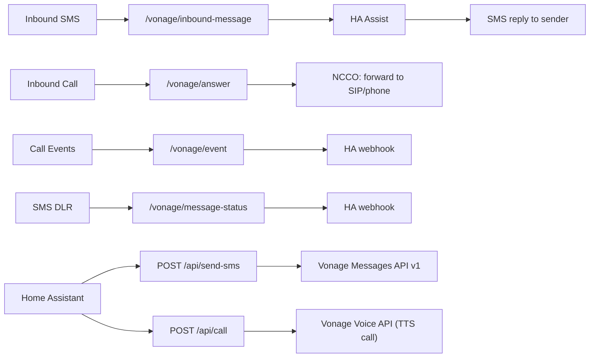

# vonage-ha-bridge

A lightweight Node.js bridge between [Vonage](https://www.vonage.com/) (formerly Nexmo) and [Home Assistant](https://www.home-assistant.io/). It lets you:

- **Receive SMS messages** and forward them to Home Assistant Assist (the voice/conversation assistant), then SMS the reply back to the sender.
- **Receive inbound phone calls** and forward them to a SIP URI or phone number.
- **Send outbound SMS messages and calls** triggered from Home Assistant via a simple internal API.
- **Forward call events and SMS delivery receipts** to Home Assistant webhooks.

---

## Table of Contents

- [How It Works](#how-it-works)
- [Prerequisites](#prerequisites)
- [Installation](#installation)
- [Configuration](#configuration)
- [Running the Service](#running-the-service)
- [API Reference](#api-reference)
- [Vonage Setup](#vonage-setup)
- [Home Assistant Setup](#home-assistant-setup)
- [Security](#security)
- [Docker](#docker)
- [Alternatives](#alternatives)

---

## How It Works



---

## Prerequisites

- Node.js 26.x
- A [Vonage account](https://dashboard.vonage.com/) with an API key, signature secret, and SMS-capable virtual number
- A Vonage Application with Messages capability (v1), application ID, and RSA private key, linked to the number
- For calls: enable the Voice capability in the same application
- For HA integration: a running Home Assistant instance with a long-lived access token
- A publicly reachable HTTPS URL for Vonage webhooks (e.g. via a reverse proxy or ngrok) — required for Messages webhooks and voice

---

## Installation

```bash
git clone https://github.com/ebertek/vonage-ha-bridge.git
cd vonage-ha-bridge/vonage-ha-bridge
npm install
```

---

## Configuration

All configuration is via environment variables. Copy the repository-root `.env.example` to your deployment environment and fill in the values. Mount the application private key read-only.

### Required

The Vonage Application is used for SMS and, optionally, Voice. Webhooks are signed
with your **account signature secret**, not your API secret or application private key.

| Variable | Description |
| --- | --- |
| `VONAGE_API_KEY` | Vonage account API key (for signed webhook JWT validation) |
| `VONAGE_APPLICATION_ID` | ID of the Messages-enabled Vonage Application |
| `VONAGE_PRIVATE_KEY_PATH` | Path to its RSA private key (default: `/run/secrets/private.key`; file must exist) |
| `VONAGE_SIGNATURE_SECRET` | Account signature secret from Vonage API Settings (for HS256 signed webhooks) |
| `VONAGE_FROM_NUMBER` | Vonage SMS-capable number, country code and digits only |
| `INTERNAL_API_TOKEN` | Strong secret for authenticating requests to `/api/*` |

`VONAGE_API_SECRET` is no longer used by the bridge for SMS sending.

### Optional — Home Assistant

Both `HA_BASE_URL` and `HA_LONG_LIVED_TOKEN` must be set together or left unset.
Required for: inbound SMS → Assist → reply, HA webhook forwarding (call events, SMS DLRs).

| Variable                   | Default             | Description                                                      |
| -------------------------- | ------------------- | ---------------------------------------------------------------- |
| `HA_BASE_URL`              | _(none)_            | Home Assistant base URL, e.g. `http://homeassistant.local:8123`  |
| `HA_LONG_LIVED_TOKEN`      | _(none)_            | Home Assistant long-lived access token                           |
| `HA_CALL_EVENT_WEBHOOK_ID` | `vonage_call_event` | HA webhook ID for call events                                    |
| `HA_SMS_DLR_WEBHOOK_ID`    | `vonage_sms_dlr`    | HA webhook ID for SMS delivery receipts                          |
| `HA_ASSIST_AGENT_ID`       | _(none)_            | HA Assist agent ID for SMS conversations (uses default if unset) |
| `HA_LANGUAGE`              | `en`                | Language code for HA Assist                                      |
| `ASSIST_TIMEOUT_S`         | `30`                | Timeout for HA Assist requests (seconds)                         |

### Optional — Voice

The application credentials above are shared with Messages API. Enable the Voice capability in Vonage if calls are needed. `BASE_URL` is additionally required for outbound calls.
See [Vonage's documentation](https://developer.vonage.com/en/voice/voice-api/concepts/text-to-speech#supported-languages) for the list of available languages and voice styles.

| Variable                  | Default                    | Description                                                                 |
| ------------------------- | -------------------------- | --------------------------------------------------------------------------- |
| `BASE_URL`                | _(none)_                   | Public base URL of this service, e.g. `https://bridge.example.com`          |
| `FORWARD_PHONE_NUMBER`    | _(none)_                   | Phone number to forward inbound calls to                                    |
| `FORWARD_SIP_URI`         | _(none)_                   | SIP URI to forward inbound calls to (takes priority over phone number)      |
| `DEFAULT_VOICE_LANGUAGE`  | `en-US`                    | Default TTS language for outbound calls (Vonage voice language code)        |
| `DEFAULT_VOICE_STYLE`     | `0`                        | Default voice style index for outbound calls (0 = default, varies by voice) |

### Optional — General

| Variable                                | Default   | Description                                                                |
| --------------------------------------- | --------- | -------------------------------------------------------------------------- |
| `PORT`                                  | `3000`    | Port to listen on                                                          |
| `LOG_LEVEL`                             | `info`    | Log level: `debug`, `info`, `warning`, or `error`                          |
| `REDACT_LOGS`                           | `true`    | Redact sensitive query params (sig, api-key, msisdn, nonce) from HTTP logs |
| `OUTBOUND_TIMEOUT_S`                    | `10`      | Timeout for outbound HTTP requests (seconds)                               |
| `ALLOWED_SMS_SENDERS`                   | _(all)_   | Comma-separated list of phone numbers allowed to send SMS                  |
| `SMS_MAX_LENGTH`                        | `1600`    | Maximum SMS message length                                                 |
| `VALIDATE_VONAGE_WEBHOOK_SIGNATURE`     | `true`    | Verify HS256 signed Messages webhooks and payload hashes; keep enabled in production |
| `OUTBOUND_CALL_RATE_LIMIT_MAX_REQUESTS` | `3`       | Max outbound call requests per window                                      |
| `OUTBOUND_CALL_RATE_LIMIT_WINDOW_S`     | `300`     | Rate limit window for outbound calls (seconds)                             |
| `OUTBOUND_SMS_RATE_LIMIT_MAX_REQUESTS`  | `5`       | Max outbound SMS requests per window                                       |
| `OUTBOUND_SMS_RATE_LIMIT_WINDOW_S`      | `15`      | Rate limit window for outbound SMS (seconds)                               |

---

## Running the Service

```bash
# Without an .env file (env vars already set in your shell)
node src/server.js

# With an .env file
node --env-file=.env src/server.js
```

Logs are emitted as newline-delimited JSON to stdout.

---

## API Reference

### Vonage Webhook Endpoints

Configure these **Messages capability** URLs in your Vonage Application.
They accept JSON `POST` webhooks signed by Vonage with an HS256 JWT.

| Method | Path | Description |
| --- | --- | --- |
| `POST` | `/vonage/inbound-message` | Incoming Messages API v1 SMS to Home Assistant Assist |
| `POST` | `/vonage/message-status` | Messages API v1 status callbacks forwarded to the existing HA SMS DLR webhook |
| `GET/POST` | `/vonage/answer` | Voice call answer URL (returns NCCO) |
| `GET/POST` | `/vonage/event` | Voice call event URL |

The legacy `/vonage/sms` and `/vonage/dlr` endpoints are no longer used.
Messages API status payloads include `message_uuid` and statuses such as
`submitted`, `delivered`, and `rejected`. The Home Assistant webhook ID
(`HA_SMS_DLR_WEBHOOK_ID`) and wrapper type (`sms_dlr`) are unchanged, but
the nested `payload` now contains the Messages API v1 fields.

### Internal API Endpoints

These require the `x-api-token` header set to your `INTERNAL_API_TOKEN`.

#### `GET /ncco/talk`

Returns a TTS NCCO used internally as the answer URL for outbound `"talk"` mode calls. The token is embedded in the URL automatically — this endpoint should not be called directly.

#### `POST /api/send-sms`

Send an outbound SMS.

**Request body:**

```json
{
  "to": "46701234567",
  "text": "Hello from Home Assistant!",
  "clientRef": "optional-ref"
}
```

#### `POST /api/call`

Initiate an outbound phone call with a text-to-speech message.

**Request body:**

```json
{
  "to": "46701234567",
  "text": "This is an automated alert from Home Assistant.",
  "language": "en-US",
  "style": 0,
  "dtmfAnswer": "1234",
  "mode": "talk"
}
```

| Field                      | Required | Description                                                                                      |
| -------------------------- | -------- | ------------------------------------------------------------------------------------------------ |
| `to`                       | Yes      | Destination phone number (digits only, with country code)                                        |
| `text`                     | Yes      | Text-to-speech message (max 1400 characters)                                                     |
| `language`                 | No       | TTS language code (defaults to `DEFAULT_VOICE_LANGUAGE`)                                         |
| `style`                    | No       | Voice style index (defaults to `DEFAULT_VOICE_STYLE`)                                            |
| `dtmfAnswer`/`dtmf_answer` | No       | DTMF digits to send automatically when the call is answered (only used in `connect` mode)        |
| `mode`                     | No       | `"talk"` (default) plays TTS via answer URL; `"connect"` uses an inline NCCO with connect action |

### Utility Endpoints

| Method | Path      | Description  |
| ------ | --------- | ------------ |
| `GET`  | `/`       | Service info |
| `GET`  | `/health` | Health check |

`GET /version` returns the running application version and requires the `x-api-token` header.

---

## Vonage Setup

1. In Vonage **API Settings**, select **Messages API** instead of the legacy SMS API.
2. In your Vonage **Application**, enable **Messages**, select **v1**, and configure:
   - Inbound URL: `https://vonage.ebi.nu/vonage/inbound-message`
   - Status URL: `https://vonage.ebi.nu/vonage/message-status`
3. **Link your SMS-capable Vonage number** to that application. Check for per-number inbound webhook overrides.
4. Mount the application's downloaded RSA private key and configure
   `VONAGE_APPLICATION_ID` and `VONAGE_PRIVATE_KEY_PATH`.
5. Set `VONAGE_API_KEY` and `VONAGE_SIGNATURE_SECRET` (the latter is in
   **API Settings**, and differs from `VONAGE_API_SECRET`).
6. If using calls, enable **Voice** in that application and configure
   `https://vonage.ebi.nu/vonage/answer` and
   `https://vonage.ebi.nu/vonage/event`.

**Important:** The Dashboard's _Webhook version for basic authentication_
setting applies to account-level configuration. For this bridge, ensure the
**Messages capability on the Application** is also set to **v1**. Sending SMS
uses the application JWT, not account-level Basic authentication.

After deployment, send an SMS to your number and check the bridge's logs for
`Inbound SMS received`. Trigger an outbound SMS and check for
`SMS accepted by Messages API` followed by status callbacks. A successful
Messages API send returns HTTP 202 with a `message_uuid`; it does **not**
confirm delivery until a later status callback.

## Home Assistant Setup

### Long-lived access token

Generate one in your HA profile page under **Long-lived access tokens** and set it as `HA_LONG_LIVED_TOKEN`.

### Webhooks

To receive call events and SMS delivery receipts in HA, create automations with a **Webhook** trigger. The webhook IDs must match `HA_CALL_EVENT_WEBHOOK_ID` (default: `vonage_call_event`) and `HA_SMS_DLR_WEBHOOK_ID` (default: `vonage_sms_dlr`).

### Sending SMS / calls from HA

Use a `rest_command` to call the internal API. Add the following block in your Home Assistant's `configuration.yaml` file:

```yaml
rest_command:
  make_call:
    content_type: "application/json"
    headers:
      x-api-token: !secret vonage_bridge_api_token
    method: POST
    payload: >-
      {
        "to": {{ to | tojson }},
        "text": {{ text | tojson }},
        "mode": {{ mode | default('talk') | tojson }},
        "language": {{ language | default('en-US') | tojson }},
        "style": {{ style | default(0) }},
        "dtmf_answer": {{ dtmf_answer | default('') | tojson }}
      }
    url: "http://localhost:3000/api/call"
  send_sms:
    content_type: "application/json"
    headers:
      x-api-token: !secret vonage_bridge_api_token
    method: POST
    payload: >-
      {
        "to": {{ to | tojson }},
        "text": {{ text | tojson }}
      }
    url: "http://localhost:3000/api/send-sms"
```

Add your `INTERNAL_API_TOKEN` in your Home Assistant's `secrets.yaml` file:

```yaml
vonage_bridge_api_token: INTERNAL_API_TOKEN
```

Then call them from an automation action:

```yaml
alias: Announce water leak
description: ""
triggers:
  - trigger: state
    entity_id:
      - binary_sensor.water_leak
    from: "off"
    to: "on"
conditions: []
variables:
  alert_number: "46701234567"
  alert_message: Water leak detected!
actions:
  - parallel:
      - action: rest_command.make_call
        data:
          to: "{{ alert_number }}"
          text: "{{ alert_message }}"
      - action: rest_command.send_sms
        data:
          to: "{{ alert_number }}"
          text: "{{ alert_message }}"
mode: restart
```

If you want to monitor your Vonage account balance, you can also add this REST sensor in your Home Assistant's `configuration.yaml` file:

```yaml
sensor:
  - platform: rest
    device_class: monetary
    json_attributes:
      - autoReload
    name: Vonage Account Balance
    params:
      api_key: !secret vonage_api_key
      api_secret: !secret vonage_api_secret
    resource: "https://rest.nexmo.com/account/get-balance"
    scan_interval: 3600
    unique_id: vonage_account_balance
    unit_of_measurement: "EUR"
    value_template: "{{ value_json.value | round(2) }}"
```

---

## Security

- All `/api/*` endpoints, `/ncco/talk`, and `/version` require the `x-api-token` header (or `x-api-token` query parameter for Vonage callbacks to `/ncco/talk`).
- Inbound SMS can be restricted to specific senders via `ALLOWED_SMS_SENDERS`.
- Messages webhooks are validated by default using the account signature secret (HS256), the `api_key` claim, and the message payload hash. Keep `VALIDATE_VONAGE_WEBHOOK_SIGNATURE=true` in production.
- Outbound SMS and call endpoints are rate-limited per destination number.
- Ensure `INTERNAL_API_TOKEN` is a strong random secret and that the service is not publicly accessible on the `/api/*` paths (place it behind a firewall or keep it on your LAN). Publicly expose only the webhook and voice endpoints required by Vonage.

---

## Docker

A pre-built image is available from the GitHub Container Registry:

```bash
docker pull ghcr.io/ebertek/vonage-ha-bridge:latest
```

### Running with Docker

```bash
docker run -d \
  --name vonage-ha-bridge \
  --env-file .env \
  -v /path/to/vonage-private.key:/run/secrets/private.key:ro \
  -p 3000:3000 \
  ghcr.io/ebertek/vonage-ha-bridge:latest
```

Make sure `VONAGE_PRIVATE_KEY_PATH` is set to the mounted path (e.g. `/run/secrets/private.key`).

### Docker Compose

```yaml
services:
  vonage-ha-bridge:
    env_file:
      - .env
    image: "ghcr.io/ebertek/vonage-ha-bridge:latest"
    ports:
      - "3000:3000"
    restart: unless-stopped
    volumes:
      - /path/to/private.key:/run/secrets/private.key:ro
```

### Building Locally

The image runs as a non-root user (`appuser`, UID `10001` by default). You can override the UID at build time:

```bash
docker build \
  --build-arg UID=10001 \
  --build-arg VERSION=dev \
  -t vonage-ha-bridge .
```

A health check is built into the image and polls `/health` every 30 seconds.

---

## Alternatives

- Easy-to-use Notify integration: [attilaszasz/vonage-homeassistant](https://github.com/attilaszasz/vonage-homeassistant)
- First-party [vibe-coded](https://www.youtube.com/watch?v=GPKvOXJXX3I) integration: [codefoster/core](https://github.com/codefoster/core/tree/codefoster/vonage/homeassistant/components/vonage)
